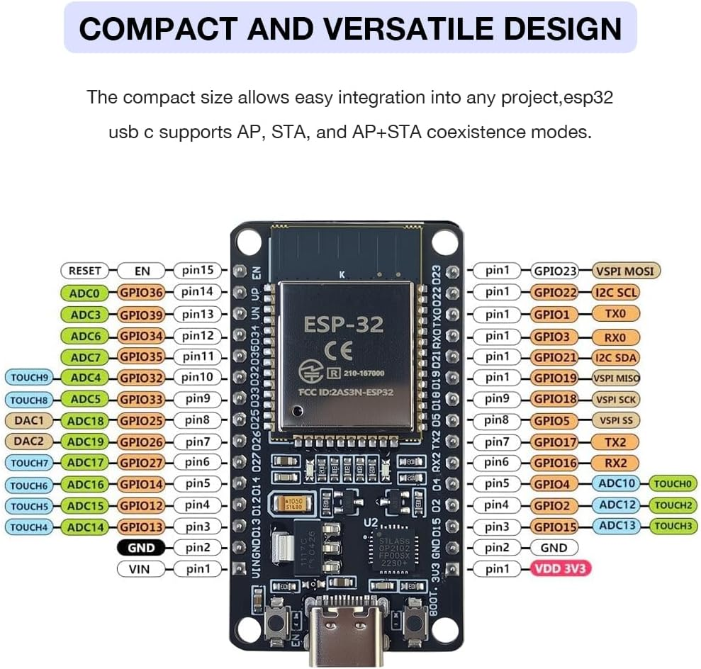
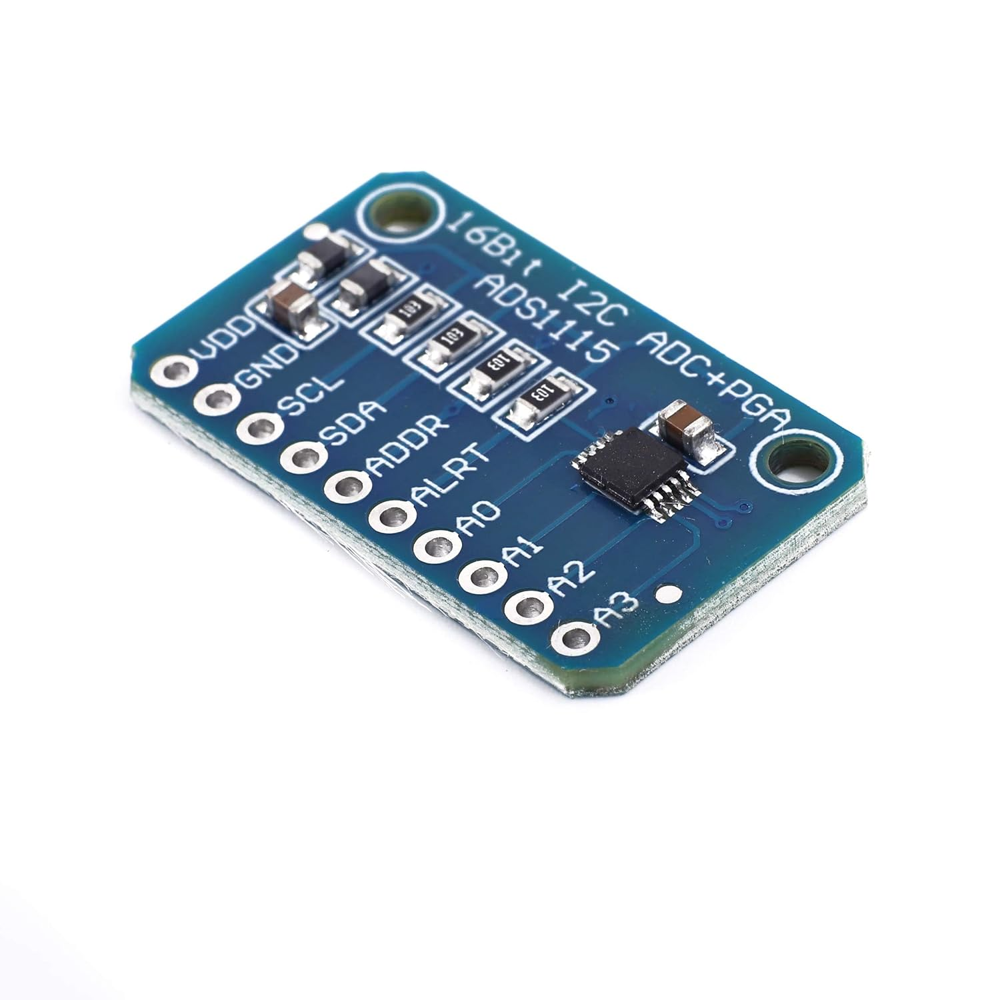
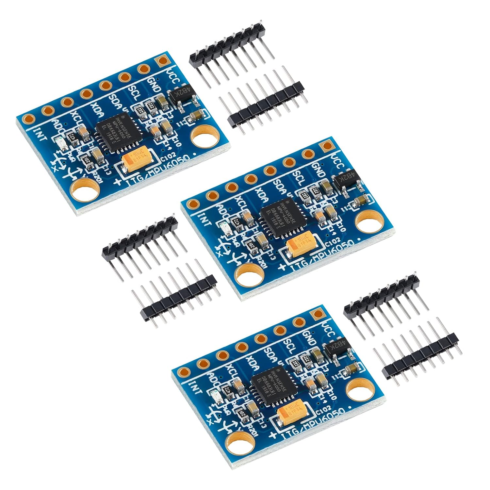
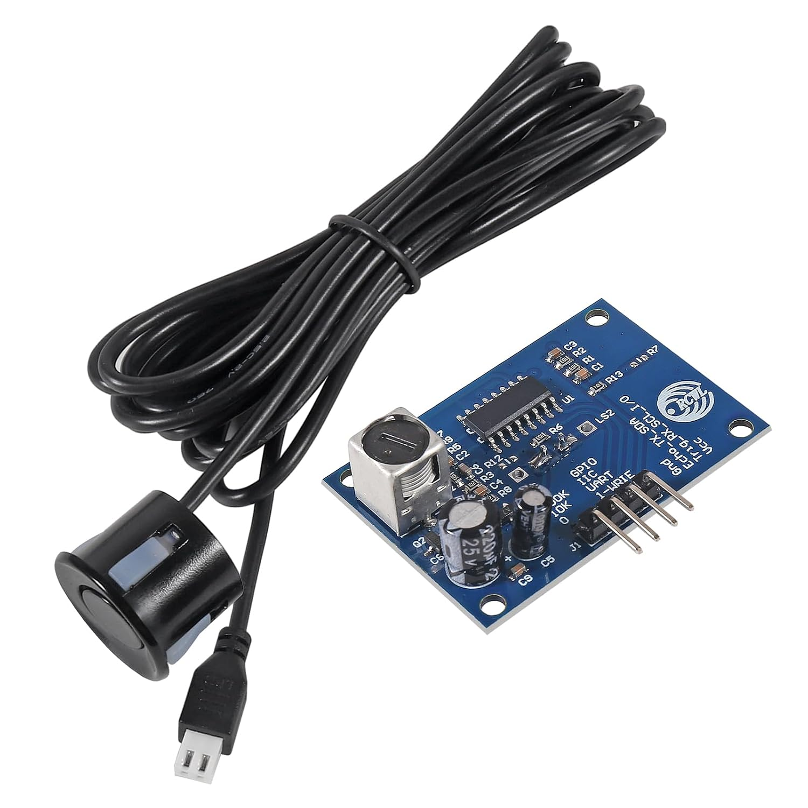
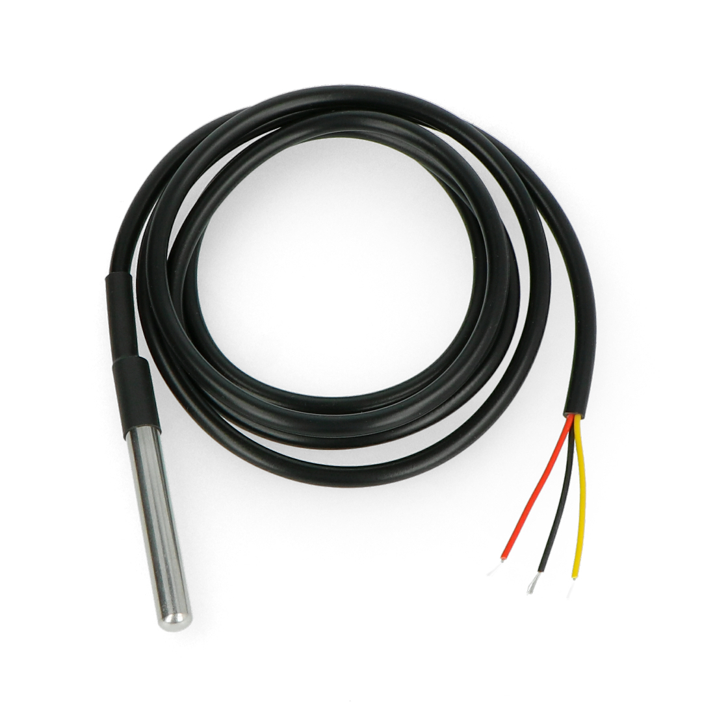
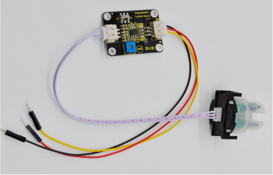
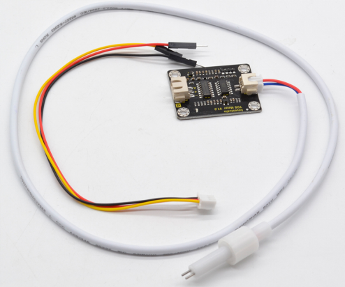
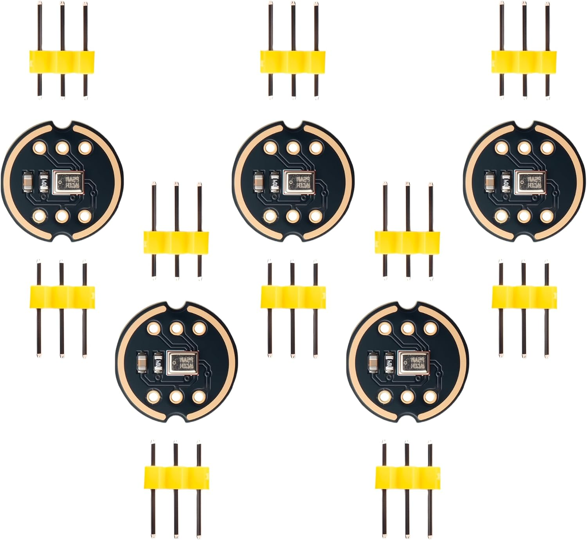
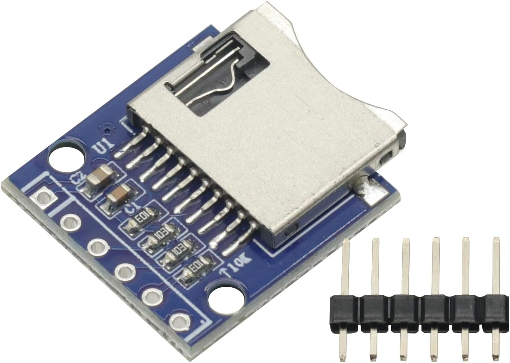

# Electronics And Sensors

The supplied product images represent the models currently installed on the buoy. They are not photographs of each individual installed unit, so confirm silkscreen, connector order, regulator, and pin labels on the physical hardware.

## ESP32 Development Board

- **Role:** Main controller, Wi-Fi link, motor PWM, sensor acquisition, audio capture, and SD logging.
- **Purchase reference:** [ESP32 development-board listing](https://www.amazon.com/dp/B0F1MS5S8R)
- **Project documentation:** [Firmware interface map](firmware-interface-map.md), [wiring index](../wiring/README.md)
- **Technical reference:** [Espressif ESP32-WROOM-32 datasheet](https://www.espressif.com/sites/default/files/documentation/esp32-wroom-32_datasheet_en.pdf)
- **Still verify:** Exact development-board manufacturer/revision and USB-UART chip.

## ADS1115 16-bit ADC

- **Role:** Reads current, battery, TDS, and turbidity signals on four analog channels.
- **Purchase reference:** [ADS1115 breakout listing](https://www.amazon.com/dp/B0CNV9G4K1)
- **Firmware:** I2C address `0x48`; channels A0-A3 are assigned in the [firmware interface map](firmware-interface-map.md).
- **Technical references:** [TI ADS1115 datasheet](https://www.ti.com/lit/ds/symlink/ads1115.pdf), [Adafruit ADS1x15 guide](https://learn.adafruit.com/adafruit-4-channel-adc-breakouts)
- **Identification:** Confirmed installed board model; the product image is marked `16Bit I2C ADS1115 ADC+PGA`.
- **Still record:** The physical board's address strap and power/pull-up arrangement.

## MPU6050 / GY-521 IMU

- **Role:** Acceleration, angular-rate, motion, wave, and motor-vibration measurements.
- **Purchase reference:** [GY-521 / MPU6050 listing](https://www.amazon.com/dp/B0B3D6D1KD)
- **Project wiring:** [MPU6050 wiring map](../wiring/mpu6050-wiring-map.md)
- **Technical reference:** [TDK/InvenSense MPU-6000 and MPU-6050 datasheet](https://invensense.tdk.com/wp-content/uploads/2015/02/MPU-6000-Datasheet1.pdf)
- **Firmware:** I2C address `0x68`; SDA `GPIO23`, SCL `GPIO27`; interrupt unused.

## HGLRC M100-5883 GPS and Compass

- **Role:** GNSS position and speed plus three-axis magnetic-field readings for future heading calibration.
- **Manufacturer reference:** [HGLRC M100-5883 product page](https://www.hglrc.com/products/m100-5883-gps)
- **Project wiring:** [GPS and compass wiring map](../wiring/gps-wiring-map.md)
- **Firmware:** GPS TX to ESP32 `GPIO16` at `115200` baud; QMC5883 compass on shared I2C `GPIO23/GPIO27`, address `0x0D`.
- **Status:** Compass raw X/Y/Z telemetry is integrated; hard/soft-iron calibration and heading display remain pending.

## JSN-SR04T V3.0 Waterproof Ultrasonic Module

- **Role:** Range/depth-style measurement.
- **Purchase reference:** [JSN-SR04T V3.0 listing](https://www.amazon.com/dp/B0DRG19Q6L)
- **Project wiring:** [JSN-SR04T V3.0 wiring map](../wiring/jsn-sr04t-v3-wiring-map.md)
- **Firmware:** `TRIG` on `GPIO13`; `ECHO` on `GPIO39`.
- **Identification:** Confirmed installed JSN-SR04T V3.0 model. The former RCWL-1655 name was removed from active firmware and wiring documentation.
- **Measurement constraint:** The documented blind zone is approximately `21 cm`. This device measures through air and should not be treated as an immersed sonar transducer.

## Waterproof DS18B20 Temperature Probe

- **Role:** Water temperature.
- **Purchase reference:** [Waterproof DS18B20 probe listing](https://www.amazon.com/dp/B0FLDSJTVV)
- **Project wiring:** [DS18B20 wiring map](../wiring/DS18B20-wiring-map.md)
- **Technical reference:** [Analog Devices DS18B20 datasheet](https://www.analog.com/media/en/technical-documentation/data-sheets/ds18b20.pdf)
- **Firmware:** 1-Wire on `GPIO14`, 12-bit resolution.
- **Still verify:** Actual probe wire colors and long-term waterproof sealing. Wire colors are not standardized.

## Keyestudio KS0414 Turbidity Sensor V1.0

- **Role:** Water-cloudiness/turbidity experiment.
- **Purchase reference:** [Keyestudio KS0414 listing](https://www.amazon.com/dp/B07Q657288)
- **Official documentation:** [Keyestudio KS0414 guide](https://docs.keyestudio.com/projects/KS0414/en/latest/docs/KS0414.html)
- **Project design:** Analog mode to ADS1115 A3 through the documented `10 kOhm / 15 kOhm` divider.
- **Safety note:** The manufacturer specifies a `5 V` supply. Only the transparent probe end is intended for immersion; the probe top and electronics board must remain dry.
- **Data status:** Firmware currently records voltage, not defensible NTU. Calibration with known standards is still required.

## Keyestudio KS0429 TDS Meter V1.0

- **Role:** Total dissolved solids experiment.
- **Purchase reference:** [Keyestudio KS0429 listing](https://www.amazon.com/dp/B08DGLY3J2)
- **Official documentation:** [Keyestudio KS0429 guide](https://docs.keyestudio.com/projects/KS0429/en/latest/docs/KS0429.html)
- **Project design:** Analog output to ADS1115 A2; published output range is `0-2.3 V`.
- **Data status:** Firmware currently records sensor voltage. Converting to ppm requires calibration and temperature compensation using the water-temperature reading.

## INMP441 Microphone Pair

- **Role:** Stereo I2S audio recording and acoustic experiments.
- **Purchase reference:** [Qoroos INMP441 listing](https://www.amazon.com/dp/B0FBWQF74T)
- **Project wiring:** [INMP441 wiring map](../wiring/inmp441-microphones-wiring-map.md)
- **Technical reference:** [TDK/InvenSense INMP441 datasheet](https://invensense.tdk.com/wp-content/uploads/2015/02/INMP441.pdf)
- **Firmware:** BCLK `GPIO5`, WS `GPIO4`, shared data `GPIO36`, 16 kHz stereo capture.
- **Identification:** Confirmed installed round Qoroos breakout model.
- **Still record:** Which microphone is strapped left versus right and whether the microphones are acoustically coupled to air or water.

## Mini TF / microSD SPI Module

- **Role:** Stores telemetry, scientific signals, logs, timestamps, and stereo audio when a card is present.
- **Purchase reference:** [Mini TF / microSD module listing](https://www.amazon.com/dp/B0F82XWT4F)
- **Identification:** Confirmed installed small six-pad TF/microSD breakout model.
- **Firmware pins:** CS `GPIO1`, SCK `GPIO17`, MOSI `GPIO26`, MISO `GPIO35`.
- **Still verify:** Exact module pin order, whether its interface is truly 3.3 V compatible, presence of level shifting/pull resistors, and maximum stable SPI speed.

## ACS712 30 A Current Sensor

- **Role:** Propulsion and system-current monitoring through ADS1115 A0.
- **Purchase reference:** [ACS712 30 A module listing](https://www.amazon.com/dp/B096VDMPR8)
- **Project wiring:** [ACS712 wiring map](../wiring/acs712-current-sensor-wiring-map.md)
- **Technical reference:** [Allegro ACS712 datasheet](https://www.allegromicro.com/-/media/files/datasheets/acs712-datasheet.ashx)
- **Firmware assumption:** `0.066 V/A`, corresponding to the 30 A chip variant, with a `0.60` input divider.
- **Still verify:** The exact module really contains the 30 A variant, terminal orientation, zero-current voltage, divider hardware, safe current capacity, and mounting.

## 0-25 V Battery Voltage Module

- **Role:** Battery-pack voltage through ADS1115 A1.
- **Project wiring:** [Battery voltage wiring map](../wiring/battery-voltage-sensor-wiring-map.md)
- **Purchase reference:** [HiLetgo voltage detection module](https://www.amazon.com/dp/B01HTC4XKY)
- **Still verify:** Divider ratio on the actual board, maximum charged-pack voltage, polarity, calibration constant, and protection against wiring faults.

## SkyGuy Nano 2.4 GHz ExpressLRS Receiver

- **Role:** Direct TX12 propulsion control and receiver link-status input to the production ESP32 firmware over UART2 MAVLink. Backpack telemetry is optional for this control path.
- **Model:** SkyGuy Nano 2.4 GHz RX, SKU `SG-NANO-2G4-RX`.
- **Purchase reference:** [SkyGuy Nano receiver listing](https://www.amazon.com/dp/B0GF1VG9QM)
- **Product specifications:** `5 V` input, `2.4 GHz`, up to `100 mW`, SX1280 radio with ESP32-C3, IPEX1 antenna connector, approximately `10 x 18 mm`, and `0.7 g` without antenna.
- **Shipped firmware:** The manufacturer currently lists ExpressLRS `3.6.0`; verify the receiver itself before updating.
- **Product page:** [SkyGuy Nano 2.4G ExpressLRS receiver](https://skyguy.com/products/skyguy-nano-2-4g-expresslrs-elrs-receiver)
- **Official protocol documentation:** [ExpressLRS documentation](https://www.expresslrs.org/)
- **Status:** Implemented in production firmware using ELRS MAVLink. CRSF is used only by the separate bench sketch.
- **Project design history:** [Archived ADS1115, ELRS, microSD, and water-quality proposal](../../archive/hardware/wiring/alternative-ads1115-elrs-microsd-water-quality-wiring.md)
- **Still verify:** Physical pin labels, receiver TX/RX orientation, a suitable ESP32 UART, antenna installation, installed firmware version, transmitter compatibility, return telemetry, and motor-stop failsafe behavior.
