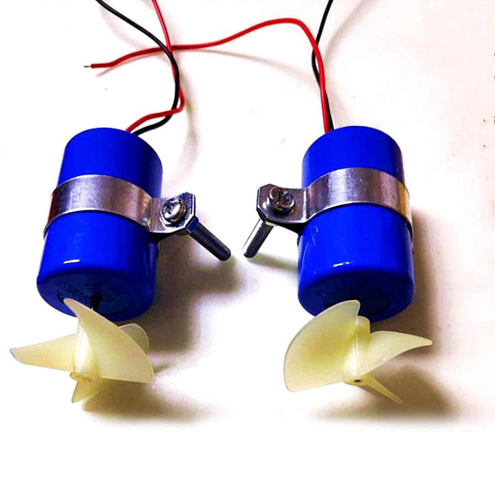
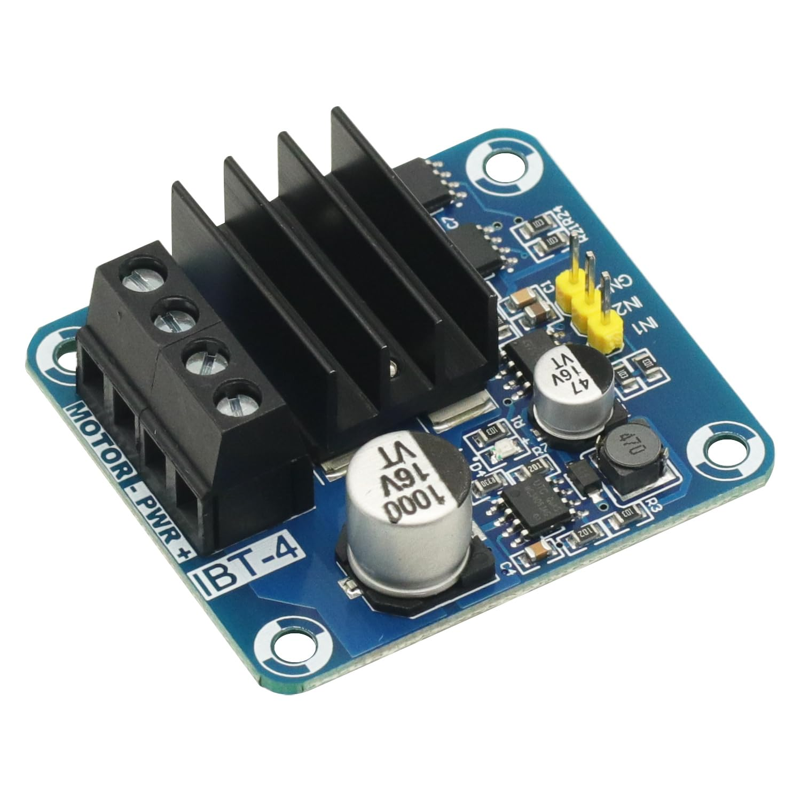

# Propulsion, Power, And Structure

## ICHIFIT Underwater Thrusters

- **Quantity:** Three: rear, front-left, and front-right.
- **Purchase reference:** [ICHIFIT underwater-thruster listing](https://www.amazon.com/dp/B07WY4MDYZ)
- **Product identification:** Confirmed installed ICHIFIT RC jet-boat underwater motor/thruster model, `7.4 V`, advertised `16800 RPM`.
- **Firmware control:** Two directional PWM outputs per motor; see [Firmware interface map](firmware-interface-map.md).
- **Still record:** Exact motor markings, no-load current, operating current, stall current, motor-to-location assignment, and rotation direction.

## Dual-PWM MOSFET H-Bridge Motor Drivers

- **Quantity:** Three, one per motor.
- **Selected purchase:** [GODIYMODULES dual-PWM MOSFET H-bridge listing](https://www.amazon.com/dp/B0DT3NCP7Q)
- **Project wiring:** [Motor wiring sheet](../wiring/motor-wiring-sheet.md)
- **Product identification:** Confirmed installed `IBT-4`-style board model with `IN1`, `IN2`, `GND`, motor, and power connections.
- **Still record:** Actual-board photos of both sides, exact terminal labels, logic-voltage range, continuous current rating, heat-sink/cooling needs, and final motor assignment.
- **Safety:** Do not rely on a marketplace peak-current claim. Verify each motor's stall current and fuse the propulsion supply appropriately.

## Bevel Gears And Drive Shafts

- **Gears:** Module 0.8, 15-tooth copper transmission bevel gears.
- **Shafts:** 3 mm propeller drive shafts; these replaced the earlier flexible 2 mm shafts.
- **Still record:** Vendor links, bore sizes, outside dimensions, shaft lengths/material, couplers, bearings/bushings, lubrication, retention method, and one photo of each assembled drive line.

## Propellers And Mounting

- **Status:** Propeller type, diameter, pitch, handedness, and final mounting are not fully documented.
- **Needed:** Photos, vendor/model, thrust direction, guards, shaft seals, and the mapping between physical propeller and firmware motor name.

## Battery And Power Distribution

- **Battery:** `12 V 2600 mAh Rechargeable Li-ion Battery Pack`. User-provided product description; exact manufacturer/model, cell configuration, discharge rating, connector, and battery-management/protection details still need confirmation from its label or datasheet. Advertised nominal voltage and capacity imply about 31.2 Wh (12 V × 2.6 Ah); actual usable energy depends on pack design and operating limits.
- **Battery purchase reference:** [12 V, 2600 mAh Li-ion battery listing](https://www.amazon.com/dp/B0D9D5L3B5)
- **Supplied charger:** The battery listing includes a `12.6 V 1 A Charger`. Use only if it is the supplied charger intended for this exact pack and its connector/polarity match. Confirm pack instructions and protection requirements; do not substitute another charger based only on matching nominal voltage.
- **Charger identified:** `MPPT Solar Charge Controller Li-ion LiFePO4 Lithium Battery Charger Module 1A 12V` (user-provided product description). Record the exact manufacturer/model and its input-voltage range, supported cell configuration, charge profile, and wiring diagram from the module label or manufacturer documentation.
- **MPPT purchase reference:** [1 A, 12 V MPPT controller listing](https://www.amazon.com/dp/B0GCCC3YV2)
- **MPPT compatibility status:** Not verified. The MPPT module's “12V” and Li-ion/LiFePO4 wording alone do not establish compatibility with this 12 V Li-ion pack. Confirm the pack's cell configuration and required charging profile, and verify the module's charging voltage/current and solar-input limits before connecting it. Do not use the MPPT module to charge this pack until that match is confirmed. The included 12.6 V, 1 A charger is a separate item and should not be confused with the MPPT module.
- **Solar panel identified:** `Epoxy Solar Panel 5.5 V 190 mA Mini Polycrystalline Solar Cell Panel`, listed dimensions 70 × 70 mm (2.76 × 2.76 in). Exact model and measured output under operating conditions are not recorded. Verify the MPPT module's required solar-input voltage; a panel rated 5.5 V may not meet its startup/charging requirements.
- **Solar-panel purchase reference:** [5.5 V, 190 mA mini panel listing](https://www.amazon.com/dp/B0DSJJRKC6)
- **Still needed:** Battery specifications and a charger datasheet/photo; solar panel specification; main and branch fuses; emergency disconnect; regulator(s); power switch; wire gauges; connectors; and grounding/distribution layout.
- **Measurement hardware:** ACS712 current sensor and 0-25 V divider feed the ADS1115.
- **Safety:** Do not commission three motors from an undocumented battery/power path.

## Waterproof Electronics Enclosure

- **Selected purchase:** [MAKERELE IP67 ABS junction box](https://www.amazon.com/dp/B09CMJZGS6)
- **Role:** Protects the ESP32, sensor interfaces, storage, and power electronics from splashes and weather.
- **Still record:** Exact dimensions, cable glands, penetrations, mounting plate, vent/pressure strategy, gasket condition, water test, and final component placement photographs.

## K'NEX Prototype Frame

- **Role:** Rapid physical prototyping for motor placement, flotation arrangement, and electronics layout.
- **Status:** Useful for early testing, not assumed to be the final marine structure.
- **Still record:** Overall dimensions, flotation placement, center of mass/buoyancy, load capacity, and photos from top, side, front, and rear.

## Operator Equipment

- **Laptop:** Runs the Python/Qt control station over Wi-Fi.
- **Xbox-style controller:** Provides manual movement input to the laptop.
- **Software documentation:** [`src/control_station/README.md`](../../../src/control_station/README.md)
